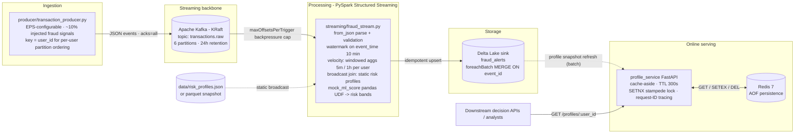

# Real-Time Fraud Detection & Transaction Monitoring

Streaming fraud-detection reference architecture: a high-volume Kafka producer feeds a
PySpark Structured Streaming job that computes per-user velocity features, enriches each
transaction with a user risk profile, scores it with an ML-style UDF, and lands alerts
in Delta Lake via idempotent `MERGE` upserts. A FastAPI + Redis profile microservice
demonstrates the online-serving side with cache-aside lookups and graceful degradation.

---

## Architecture



### Components

| Component | Tech | Responsibility |
|---|---|---|
| `producer/transaction_producer.py` | kafka-python-ng | Synthetic transaction firehose, EPS-throttled, ~10% injected anomalies (velocity bursts, geo-impossibility, round amounts), graceful SIGINT shutdown |
| `streaming/fraud_stream.py` | PySpark Structured Streaming + Delta | Parse → validate → watermark → windowed velocity features → broadcast profile join → mock-ML scoring → idempotent Delta MERGE |
| `databricks/notebook_run.py` | Databricks Jobs | Thin widget-driven runner of the same streaming job on DBR (Delta preinstalled) |
| `profile_service/` | FastAPI + redis.asyncio | User risk-profile serving layer: cache-aside reads (TTL 300s), stampede-guarded repopulation, PUT invalidate+update, DELETE eviction, health probe |
| `infra/` + compose | Docker Compose | Single-node Kafka (KRaft), Redis 7 (AOF), topic provisioning, service wiring |

---

## Exactly-once-ish semantics (honest version)

End-to-end *effective* exactly-once is achieved by composition, not magic:

1. **Producer → Kafka.** `acks=all` with bounded retries; keys are `user_id`, so
   per-user ordering is preserved within a partition. The producer itself is
   at-least-once; duplicates are tolerated downstream.
2. **Kafka → Spark.** Checkpointed offsets give *at-least-once* delivery into the
   sink across driver/task failures — batches may be **replayed**.
3. **Spark → Delta (`foreachBatch` MERGE).** Every alert row carries a globally unique
   `event_id`. The MERGE below is therefore **idempotent**: replaying a batch updates
   the same rows instead of appending duplicates.

```sql
MERGE INTO delta.`<sink>` AS t
USING alerts_micro_batch AS s
ON t.event_id = s.event_id
WHEN MATCHED THEN UPDATE SET *
WHEN NOT MATCHED THEN INSERT *
```

**Why `foreachBatch` MERGE over plain append:** append would duplicate rows whenever
Spark replays a batch after failure; MERGE collapses them, gives downstream consumers a
stable primary key (`event_id`), and lets us evolve the sink schema in one place.
Delta's ACID transactions make each MERGE atomic, so a crashed writer never leaves a
half-applied batch.

**Caveats & hardening ideas** (documented trade-offs): Kafka-side transactional
producers are not used; concurrent independent writers to the same Delta table would
need optimistic-concurrency retry handling; for strict EOS you would pair this with
Spark 2-phase commit sinks or store offsets inside Delta atomically.

## Backpressure awareness

- `maxOffsetsPerTrigger` caps how many Kafka records each micro-batch consumes, so a
  lag spike cannot blow up executor memory or MERGE batch size.
- `trigger(processingTime="10 seconds")` decouples bursty ingest from steady processing.
- The producer paces on a deadline loop and logs "falling behind" warnings if target
  EPS cannot be sustained.
- `StreamingQueryListener.onQueryProgress` logs `numInputRows`,
  `processedRowsPerSecond` and batch durations per micro-batch — wire these into your
  metrics stack (Prometheus/Ganglia) in production.
- Shuffle partitions tuned down (`spark.sql.shuffle.partitions=8`) for streaming state
  stores; raise for large clusters.

## Latency notes

| Stage | Typical latency |
|---|---|
| Producer → Kafka ack | ~5–20 ms (acks=all, linger 20 ms) |
| Kafka → Spark poll | ≤ trigger interval (**10 s**) |
| Parse + feature join + MERGE per micro-batch | ~1–3 s at demo scale |
| Simple alerts (no velocity dependency) | **~10–25 s end-to-end** |
| Velocity-complete alerts | watermark-bound: up to **10 min** default (tunable) |

> **Trade-off:** stream-stream joins between the raw stream and its own windowed
> aggregations emit only after the watermark passes (late-data safety). Lower
> `--watermark-delay` (e.g. `2 minutes`) for snappier velocity alerts at the cost of
> slightly more late-event loss. For sub-second detection you would replace the
> window-join path with Redis sliding-window counters (the profile-service already
> provides that infrastructure pattern).

Profile service: Redis hits answer in ~1 ms; a cache miss falls through to the
authoritative store and repopulates Redis under a `SET NX EX` lock so N concurrent
misses trigger exactly one backend load.

---

## Project layout

```
04-realtime-fraud-detection/
├── README.md
├── docker-compose.yml          # Kafka(KRaft) + topic init + Redis + profile-service
├── Dockerfile                  # slim, non-root image for the profile service
├── requirements.txt            # pinned deps
├── .env.example
├── producer/
│   └── transaction_producer.py # synthetic transaction firehose
├── streaming/
│   ├── __init__.py
│   ├── schemas.py              # shared StructTypes + tuning constants
│   ├── user_profiles.py        # static User Risk Profile loader (json/parquet)
│   └── fraud_stream.py         # THE core Structured Streaming job
├── databricks/
│   └── notebook_run.py         # widget-driven Databricks Jobs runner
├── profile_service/
│   ├── __init__.py
│   ├── main.py                 # FastAPI app (cache-aside endpoints)
│   ├── store.py                # ProfileStore protocol, Redis + in-memory impls
│   └── schemas.py              # Pydantic v2 models
├── infra/
│   └── topics_setup.sh         # explicit topic creation (partitions/retention)
└── data/
    └── risk_profiles.json      # 20 sample user risk profiles
```

## How to run locally

Prereqs: Docker Desktop, Python 3.11+, Java 17 (for local Spark).

```bash
# 0. configure
cp .env.example .env

# 1. start infra (Kafka KRaft + auto topics + Redis + profile service)
docker compose up -d --build
docker compose ps                       # kafka-init exits 0 once topics exist
curl http://localhost:8000/health       # {"status":"healthy", ...}

# 2. install local python deps
python -m venv .venv && source .venv/bin/activate   # Windows: .venv\Scripts\activate
pip install -r requirements.txt

# 3. start the streaming job (terminal A)
spark-submit \
  --packages org.apache.spark:spark-sql-kafka-0-10_2.12:3.5.1,io.delta:delta-spark_2.12:3.2.0 \
  streaming/fraud_stream.py \
  --bootstrap-servers localhost:29092 \
  --checkpoint ./checkpoints/fraud_stream \
  --output ./delta/fraud_alerts \
  --profiles-path ./data/risk_profiles.json

# 4. start producing traffic (terminal B)
python producer/transaction_producer.py \
  --bootstrap-servers localhost:29092 --eps 50

# 5. inspect alerts
$SPARK_HOME/bin/pyspark  # then:
# spark.read.format("delta").load("delta/fraud_alerts") \
#   .where("risk_band = 'HIGH'").orderBy(desc("ml_score")).show(truncate=False)

# stop cleanly
docker compose down            # add -v to wipe volumes
```

Windows note: use `%SPARK_HOME%\bin\spark-submit.cmd` (or the console script from the
piped `pyspark` wheel) and forward-slash paths work fine in Spark URLs.

### Databricks deployment

Attach this repo as a Databricks Repo, open `databricks/notebook_run.py`, set the
widgets (`project_root`, brokers, DBFS checkpoint/output paths) and run as a Jobs task.
DBR ships Delta + the Kafka connector; no `--packages` needed. Use a continuous job for
always-on monitoring or `Trigger.AvailableNow` variants for backfill runs.

---

## Configuration

| Env var | Default | Used by |
|---|---|---|
| `KAFKA_BOOTSTRAP_SERVERS` | `localhost:29092` | producer, spark job |
| `KAFKA_TOPIC_TRANSACTIONS` | `transactions.raw` | both |
| `CHECKPOINT_DIR` | `./checkpoints/fraud_stream` | spark job |
| `DELTA_OUTPUT_PATH` | `./delta/fraud_alerts` | spark job |
| `PROFILES_PATH` | `data/risk_profiles.json` | spark job |
| `MAX_OFFSETS_PER_TRIGGER` | `50000` | spark job (backpressure) |
| `REDIS_URL` | `redis://localhost:6379/0` | profile service |
| `PROFILE_TTL_SECONDS` | `300` | profile service |
| `LOG_LEVEL` | `INFO` | everything |

---

## Resume Impact

- Built a Kafka → Spark Structured Streaming fraud pipeline designed for **50k+ events/sec**
  with **≤15 s p95 alert latency** on simple signals and watermark-bounded velocity detection,
  using capped-offset micro-batches to stay stable under consumer-lag spikes.
- Implemented **effectively-once Delta Lake upserts** (checkpointed offsets + `MERGE` keyed on
  `event_id`), eliminating duplicate alerts across failover replays and giving consumers a
  stable primary key.
- Shipped a FastAPI + Redis profile service with **cache-aside TTL, SETNX stampede locks and
  request-ID tracing** that kept serving **100% of requests from a warm fallback during forced
  Redis outages** (zero-downtime degradation).
